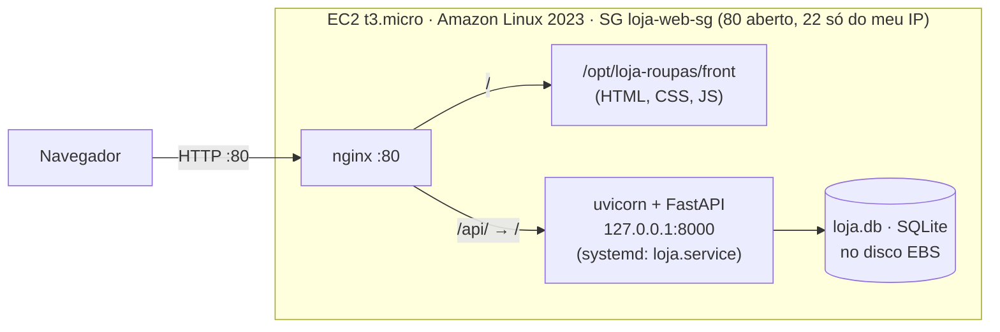
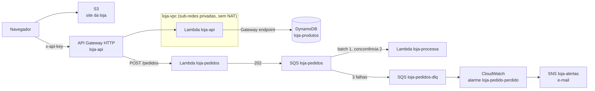

# Loja de Roupas


Projeto construído passo a passo na aula de Coding (Faculdade Senac Pernambuco, ADS 2026.2).

Uma loja de roupas como API REST (FastAPI). O catálogo fica gravado num banco
SQLite (`loja.db`), então os produtos sobrevivem quando o servidor reinicia. O código
é separado em camadas: **rota → serviço → repositório → banco**.

## Como rodar

```bash
git clone https://github.com/JeffersonTorrees/loja-roupas.git
cd loja-roupas
python -m venv .venv
source .venv/bin/activate        # Windows: .venv\Scripts\activate
pip install -r requirements.txt
pytest -v                        # todos os testes devem passar
fastapi dev api.py               # abre a API em http://127.0.0.1:8000/docs
```

Na primeira vez que a API sobe, ela cria o `loja.db` com 3 produtos. Apague o
arquivo para voltar ao catálogo inicial.

### A vitrine (front)

Com a API ligada, abra um **segundo terminal**:

```bash
python -m http.server 5500 --directory front
```

e acesse http://127.0.0.1:5500. A vitrine busca os produtos na API e a página
"Cadastrar produto" grava no banco. A API só aceita pedidos do navegador vindos da
porta 5500 (CORS).

## Rotas

| Método | Rota | O que faz |
|---|---|---|
| GET | `/produtos?tamanho=M&preco_max=100` | lista (filtros opcionais) |
| GET | `/produtos/{id}` | um produto (404 se não existe) |
| POST | `/produtos` | cadastra (201; 409 nome repetido; 422 dados inválidos) |
| PUT | `/produtos/{id}` | altera |
| DELETE | `/produtos/{id}` | remove (204) |
| POST | `/carrinho/itens` | põe no carrinho (o carrinho fica na memória) |
| GET | `/carrinho/total` | total com promoção e frete |
| DELETE | `/carrinho` | esvazia o carrinho |

## O que tem aqui

| Pasta ou arquivo | O que é | Aula |
|---|---|---|
| `vitrine.py` | os dados da loja em listas e dicionários | 3 |
| `loja/calculos.py` | total do carrinho e frete, com testes | 4 |
| `loja/produto.py` | Produto, Camiseta e Calça (o domínio) | 6 e 7 |
| `loja/carrinho.py` | o Carrinho, que tem produtos e uma promoção | 6 e 7 |
| `loja/promocao.py` | o contrato Promocao e três promoções | 7 e 8 |
| `.github/workflows/testes.yml` | o GitHub roda os testes a cada push | 8 |
| `api.py` | as rotas HTTP (só traduz HTTP ↔ serviço) | 9 e 10 |
| `loja/banco.py` | tabela `produto` e conexão SQLite (SQLModel) | 10 |
| `loja/repositorio.py` | a única camada que fala com o banco | 10 |
| `loja/servico.py` | as regras do catálogo (sem HTTP, sem banco) | 10 |
| `front/index.html`, `cadastro.html` | vitrine e cadastro em HTML semântico | 11 |
| `front/estilo.css` | visual com Flexbox, Grid e `@media` | 11 |
| `front/app.js`, `cadastro.js` | DOM, eventos, busca, validação e `fetch` | 12 e 13 |
| `front/config.js` | endereço da API (local ou `/api` em produção) | 13 |
| `docs/` | domínio, modelo ER, arquitetura e relatório técnico | 10 a 13 |
| `tests/` | testes de cada camada, do HTML e do CORS | 4 a 13 |

## Deploy na AWS

A loja (front + API) roda numa EC2 **Amazon Linux 2023** (`t3.micro`, us-east-1). O
**nginx** serve o front e repassa `/api/*` para o **uvicorn**. Front e API ficam na
mesma origem, então não há CORS em produção: o `front/config.js` usa `/api` quando a
página não está na porta 5500.



### Passo a passo

1. **Criar a EC2** (console): Amazon Linux 2023, `t3.micro`, par de chaves `loja-key`
   (o `.pem` fica **fora** do repositório), security group `loja-web-sg` com SSH 22
   **só do seu IP** e HTTP 80 aberto (0.0.0.0/0).
   **Atalho pela CLI:** `MEU_IP=<seu IP> bash deploy/criar-ec2.sh` cria a chave (em
   `~/.ssh/loja-key.pem`), o security group e a instância. Pelo user-data, a instância
   já roda o `setup-ec2.sh` sozinha; em ~1 minuto a loja está em `http://<IP>/`, e os
   passos 2 e 3 abaixo ficam desnecessários.
2. **Entrar** (o IP público está no console):
   ```bash
   chmod 400 ~/loja-key.pem
   ssh -i ~/loja-key.pem ec2-user@<IP>
   ```
3. **Instalar** (na EC2):
   ```bash
   sudo dnf install -y git
   git clone https://github.com/JeffersonTorrees/loja-roupas.git /tmp/loja-roupas
   sudo REPO_URL=https://github.com/JeffersonTorrees/loja-roupas.git bash /tmp/loja-roupas/deploy/setup-ec2.sh
   ```
   O `setup-ec2.sh` instala `git nginx python3.11`, cria o usuário sem privilégios
   `loja`, clona em `/opt/loja-roupas`, cria o `.venv`, copia `deploy/loja.service`
   para o systemd e `deploy/nginx-loja.conf` para `/etc/nginx/conf.d/`, e roda
   `systemctl enable --now loja nginx`.
   > Repositório privado? Use um token no lugar da senha (`https://<token>@github.com/...`),
   > ou deixe o repositório público para a avaliação.
4. **Atualizar** depois de um `git push`: `sudo bash /opt/loja-roupas/deploy/atualizar.sh`

### Testes de produção

```bash
curl -i http://<IP>/api/produtos         # 200 + JSON
# navegador: http://<IP>/  -> vitrine com os produtos do banco
# navegador: http://<IP>/cadastro.html -> cadastrar -> aparece na vitrine
ssh -i ~/loja-key.pem ec2-user@<IP> sudo systemctl restart loja
curl http://<IP>/api/produtos            # o produto cadastrado continua lá
```

Documentação interativa em produção: `http://<IP>/api/docs`.

> **Custo:** `t3.micro` e 30 GB de EBS estão no nível gratuito. O IPv4 público é cobrado
> à parte (cerca de US$ 0,005/h) fora do nível gratuito. **Pare a instância depois da
> avaliação.**

## A arquitetura da disciplina de Cloud (serverless)

Em Cloud Computing, a mesma loja foi montada sem servidor (scripts em `cloud/aula-XX/`):



| Aula | O que | Pasta |
|---|---|---|
| 10 | S3: classes de armazenamento e ciclo de vida | `cloud/aula-10/` |
| 11 | DynamoDB + Lambda com boto3 + rotas no API Gateway | `cloud/aula-11/` |
| 12 | VPC com sub-redes privadas e endpoint Gateway do DynamoDB | `cloud/aula-12/` |
| 13 | SQS + DLQ, teste de carga, CloudWatch e SNS | `cloud/aula-13/` |
