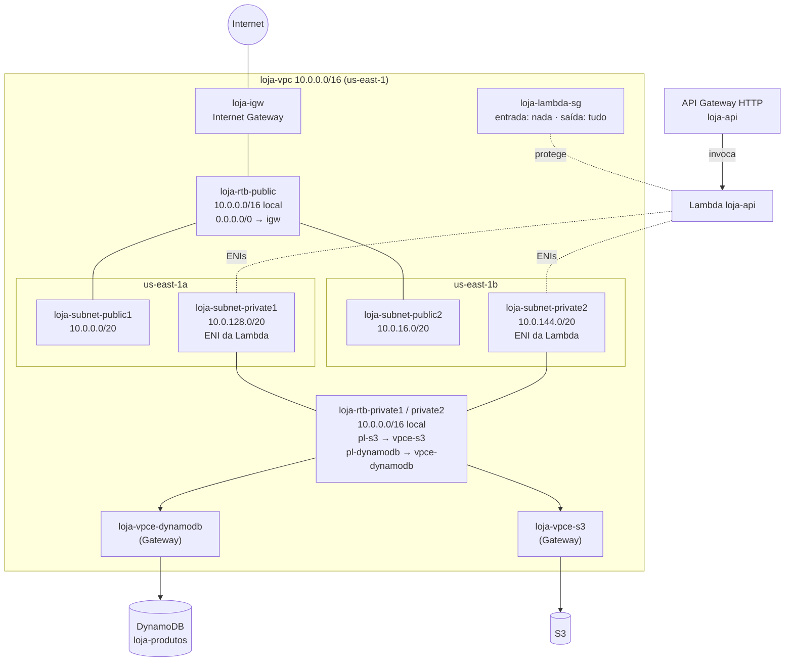

# Aula 12 — A loja ganha rede (VPC `loja-vpc`, 10.0.0.0/16)

**Não há NAT Gateway.** As sub-redes privadas não têm rota para a internet. Elas só
alcançam a própria VPC e, pelos endpoints Gateway (gratuitos), o S3 e o DynamoDB.

## Por que existe cada peça pública

| Peça | Justificativa |
|---|---|
| `loja-igw` (Internet Gateway) | é a porta da VPC para a internet; sem ele nada na VPC fala com fora. Hoje só as sub-redes públicas o usam. |
| `loja-subnet-public1/2` | reservam espaço, em 2 AZs, para o que precisa ser alcançado da internet (um load balancer ou um bastion no futuro). A Lambda **não** fica nelas. |
| `loja-rtb-public` | a única tabela com `0.0.0.0/0 → igw`; é ela que torna uma sub-rede "pública". |
| API Gateway (fora da VPC) | é o único ponto de entrada público da loja; recebe HTTPS e invoca a Lambda, que fica escondida nas privadas. |

## O que aconteceu nos testes

1. Lambda nas privadas, sem endpoint do DynamoDB: o `boto3` tenta
   `dynamodb.us-east-1.amazonaws.com`, mas não há rota. Resultado: "Task timed out
   after 3.00 seconds", e o API Gateway responde **502**.
2. Com o `loja-vpce-dynamodb` nas 2 tabelas privadas, a rota `pl-… → vpce-…` leva o
   tráfego ao DynamoDB pela rede da AWS, sem internet. Resultado: **200 / 404 / 201 / 409**.
