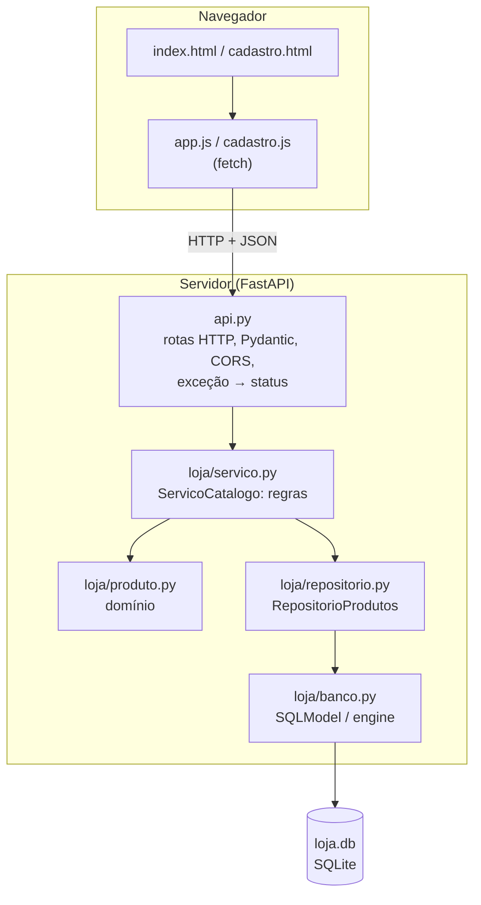
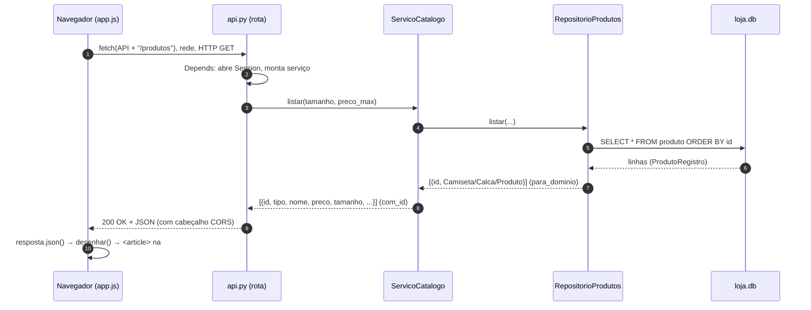

# Arquitetura em camadas (rascunho)

Cada camada só conversa com a de baixo. Quem está em cima não sabe *como* a de baixo
funciona: o serviço não sabe que o banco é SQLite; a rota não sabe que existe SQL.

## A viagem de um GET

`GET /produtos` saindo da vitrine e voltando como cartões na tela:

Se algo dá errado no caminho, o serviço levanta uma exceção do domínio
(`ProdutoNaoEncontrado`, `ProdutoJaExiste`, `DadosInvalidos`) e o `api.py` a traduz
para 404, 409 ou 422. Se a API nem responde, o `catch` do `app.js` mostra
"Não foi possível falar com a API. Ela está ligada?".
