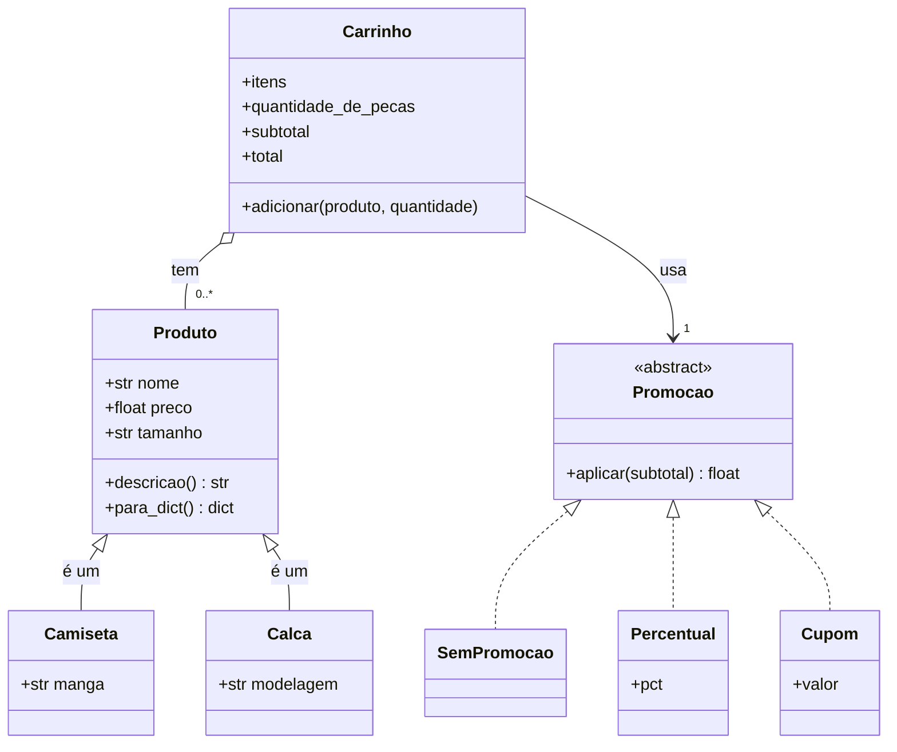

# Diagrama de domínio (rascunho)

As classes que representam o negócio da loja (`loja/produto.py`, `loja/carrinho.py`,
`loja/promocao.py`). Nenhuma delas sabe de HTTP ou de banco.

## Regras que o domínio garante

- Nome não pode ser vazio; preço tem que ser maior que zero.
- Tamanho só pode ser PP, P, M, G ou GG.
- Camiseta tem manga `curta` ou `longa`; Calça tem modelagem.
- Frete grátis a partir de R$ 200 (em `loja/calculos.py`); a promoção da semana é `Percentual(10)`.
