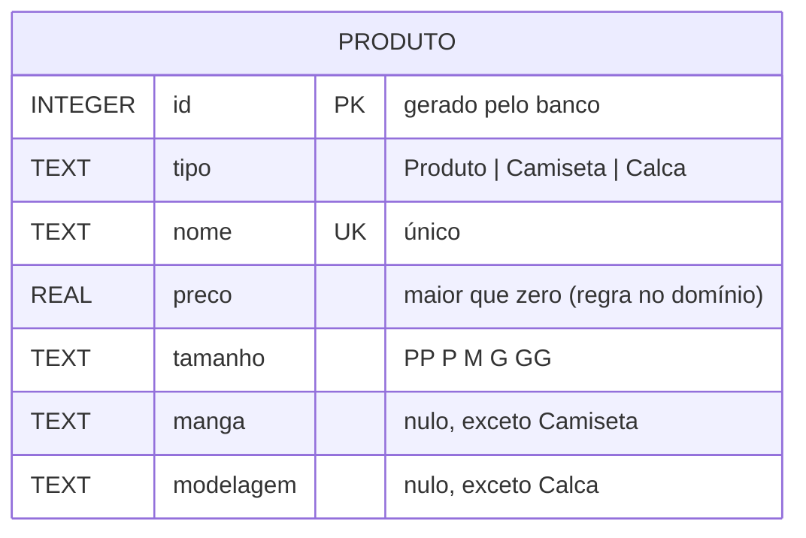

# Modelo ER (rascunho)

Uma tabela só, `produto`, no arquivo SQLite `loja.db` (definida em `loja/banco.py`,
classe `ProdutoRegistro`). Herança no domínio vira **uma tabela com a coluna `tipo`**
(single table inheritance): as colunas que só um tipo usa ficam nulas nos outros.

| Coluna | Tipo | Restrição | Quem usa |
|---|---|---|---|
| `id` | INTEGER | PK, autoincremento | todos |
| `tipo` | TEXT | NOT NULL | todos (decide a classe ao ler) |
| `nome` | TEXT | NOT NULL, UNIQUE | todos |
| `preco` | REAL | NOT NULL | todos |
| `tamanho` | TEXT | NOT NULL | todos |
| `manga` | TEXT | NULL | Camiseta |
| `modelagem` | TEXT | NULL | Calca |

O carrinho **não** tem tabela: continua na memória do servidor (fica para depois).
